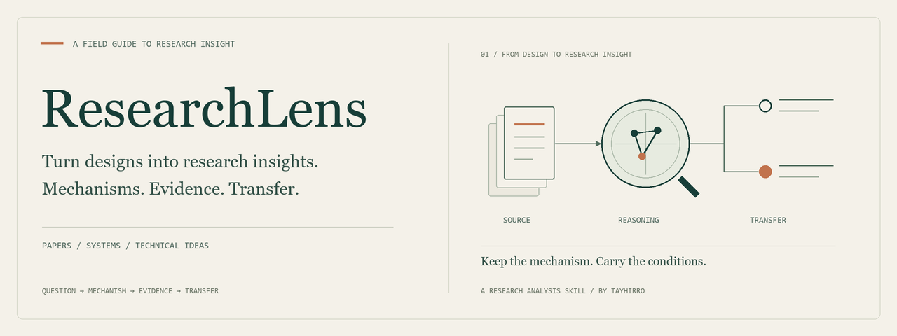

<div align="center">



# ResearchLens

### 把别人的设计，变成自己的研究启发。

面向论文、软件系统与技术方案的深度研究分析 skill。

[](SKILL.md)
[](#你会得到什么)
[](README_EN.md)

[分析示例](docs/example-analysis.md) · [快速开始](#快速开始) · [同类对比](#它在研究工作流中的位置) · [方法与规则](SKILL.md)

</div>

---

读一篇论文、研究一个开源系统，除了理解它做了什么，你还想知道：**为什么这样设计？创新究竟改变了什么？这套思路能给我的研究带来什么？**

ResearchLens 从具体设计出发，追问底层假设与替代方案，把核心创新拆成因果机制，再用文献、实验结果与反例校准判断。需要借鉴时，进一步提炼可迁移的原理、成立条件和待验证问题，整理成能继续使用的研究笔记。

> **问题 → 机制 → 证据 → 边界 → 迁移**
>
> 读懂设计背后的原理，让下一次研究与设计有据可循。

## 特色在哪里

**追问设计为什么这样选。** 从基本假设和约束重新推导：还有哪些方案？当前选择是由问题决定，还是由数据、算力或工程习惯促成？把作者的动机与实际机制放在一起判断。

**逐个拆解核心创新。** 对每项重要创新或设计决策，讲清楚“原有困难 → 具体改动 → 行为如何改变 → 证据支持到哪里 → 何时失效”。你能看到贡献成立的路径，也能找到值得继续追问的环节。

**让跨领域联系有依据。** 把具体机制与其他学科的概念建立对应，查证相关文献，说明哪些关系有直接支持、哪些属于综合推断。每次映射都带上成立条件和限制，方便判断能否借鉴。

**沿关键问题深挖，再带回你的工作。** 根据证据缺口选择下一步调查，逐项查证与你目标相关的机制、反例和迁移条件，保留尚未解决的部分。最后留下可复用原则，以及需要继续验证的假设。

## 你会得到什么

| 你真正关心的问题 | 分析会交付什么 |
|---|---|
| 这篇论文或这个系统在做什么？ | 主线、核心问题、结构、模块关系与设计目标 |
| 为什么采用这个机制？还有什么选择？ | 基本前提、替代方案、设计取舍与因果链 |
| 作者的结论真的有依据吗？ | 支持证据、反证与缺口，区分直接支持、综合推断和未确定部分 |
| 哪些创新或设计决策值得深入？ | 对核心单元逐项分析：痛点 → 修改点 → 机制 → 证据 → 边界 |
| 能借鉴到我的研究或项目中吗？ | 可迁移原则、目标场景所需条件、映射限制与风险 |

最终笔记按你的问题组织；各子问题的调研文件保留来源与分析过程。

## 从一项设计中，带走一条可迁移原则

以本 skill 的“由主 agent 决定后续调研”为例：

| 分析步骤 | 讲解示例 |
|---|---|
| **问题** | 如何让子问题不断深入，同时控制范围扩张？ |
| **机制** | 子 agent 返回证据、缺口和候选问题；主 agent 合并候选，只提升影响最终判断的问题 |
| **证据** | 调度规则直接支持这一设计意图；其效果仍需实际任务验证 |
| **边界** | 独立上下文不自动意味着独立证据；主 agent 也可能误判优先级 |
| **迁移** | 可借鉴到长文审查或技术选型中，前提是能定义清楚的子问题与判断标准 |

你可以带走的原则是：**给局部探索留出发现空间，让后续投入始终受整体目标约束。** 在长文审查或技术选型中，可保留这一组织关系，并检查子任务边界和负责人判断能力。

这是基于仓库规则整理的**讲解示例**，未作为 skill 实跑或效果评测。完整来源与推理见[示例笔记](docs/example-analysis.md)。

## 快速开始

### 1. 安装完整目录

以下为首次手动安装。需要 Git，以及支持读取 skill 文件的 agent 环境。

**Codex · Windows PowerShell**

```powershell
git clone https://github.com/Tayhirro/explore-skill.git
New-Item -ItemType Directory -Force "$env:USERPROFILE\.codex\skills" | Out-Null
Copy-Item -Recurse .\explore-skill "$env:USERPROFILE\.codex\skills\explore-skill"
```

**Codex · macOS / Linux**

```bash
git clone https://github.com/Tayhirro/explore-skill.git
mkdir -p ~/.codex/skills
cp -R explore-skill ~/.codex/skills/explore-skill
```

重新启动会话，让环境加载 skill。已经安装的用户请更新原安装目录，避免重复复制形成嵌套文件夹。

安装时保留 `SKILL.md`、三个 `config-*.md` 和整个 `tasks/` 目录。对象配置与任务协议是执行流程的一部分。

其他支持 Agent Skills 的环境，可按其安装方式加载完整目录；实际查证需要可用的检索工具，复杂任务还需要子 agent 能力。

### 2. 给出材料与问题

```text
用 explore-skill 分析这篇论文：
<论文链接或本地 PDF 路径>

我想知道每个核心创新解决了什么问题，
机制为什么成立，实验支持到了哪一步，
以及哪些原理能迁移到我的研究中。
```

也可以分析系统或技术方案：

```text
用 explore-skill 对比这两个系统的架构：
<仓库 A> <仓库 B>

重点分析关键设计决策、替代方案、成立条件，
以及对我的项目有哪些可迁移的原则。
项目约束：<你的场景与约束>
```

当前协议要求先确认分析规划。问题类型决定后续深度：简单机制可直接解释，深入创新分析和多对象对比有更完整的查证要求。

## 它在研究工作流中的位置

研究工具可以帮助你读懂已有工作、确定研究方向、运行实验或组织论文写作。ResearchLens 集中在**对已有对象的机制理解、证据判断与原理迁移**。

| 相邻 skill / 项目 | 其主要侧重 | ResearchLens 的侧重 |
|---|---|---|
| [Nature Paper X-Ray](https://github.com/Yuan1z0825/nature-skills/tree/main/skills/nature-paper-xray) | 单篇论文精读、公式微例子、设计取舍与证据边界 | 将论文、系统与技术方案纳入同一分析方法，并按问题组织外部查证和迁移判断 |
| [Academic Research Skills](https://github.com/Imbad0202/academic-research-skills) | 文献综合、研究报告、写作、评审与修订 | 围绕核心机制或设计决策形成研究笔记 |
| [Feynman](https://github.com/Companion-Inc/feynman) | 检索、引用验证、研究简报、审查和实验等 CLI 工作流 | 以 skill 指令组织问题分析和研究笔记，检索由宿主提供 |
| [Research Companion](https://github.com/andrehuang/research-companion) | 构思、评估研究方向，决定推进、暂存或放弃 | 从已有论文、系统或方案中提炼机制、边界和可迁移原则 |
| [ARIS](https://github.com/wanshuiyin/Auto-claude-code-research-in-sleep) | 跨模型互审、实验和研究改进循环 | 主 agent 管理同级子问题查证，按需深化与综合 |
| [Autoresearch](https://github.com/karpathy/autoresearch) | 用实验指标反馈，保留改进、舍弃失败改动 | 用证据支持程度校准研究判断 |

ResearchLens 将**设计动机、因果机制、学术依据与迁移条件**连成一条可回查的分析链，为选题思考、技术选型和后续实验提供可继续追问的研究材料。完整对比见[对比与定位笔记](docs/positioning.md)；依据公开协议，未做效果排名。

## 方法如何组织


- **先理解原对象。** 外部资料用于补充或核对，保留原文、系统结构和实际问题作为主线。
- **逐项检查关键单元。** 用具体机制或设计决策组织分析，记录后续候选问题的处理理由。
- **只深化重要缺口。** 主 agent 统一调度；子 agent 返回候选问题，不再创建下级 agent。
- **证据不足就降低结论强度。** 保留不确定性，说明引用、推断和映射的支持范围。
- **按任务选择深度。** 当前规则包含定向检索、聚焦补查、关键断言验证，也允许主 agent 调度后续深化。

具体执行以 [SKILL.md](SKILL.md)、对象配置和任务协议为准。

<details>
<summary><strong>查看文件结构与执行入口</strong></summary>

```text
explore-skill/
├── SKILL.md
├── config-paper.md
├── config-system.md
├── config-tech.md
├── tasks/
├── README.md
├── README_EN.md
├── assets/
└── docs/
```

| 入口 | 用途 |
|---|---|
| [SKILL.md](SKILL.md) | 核心方法、调度与综合规则 |
| [config-paper.md](config-paper.md) | 论文、算法与综述 |
| [config-system.md](config-system.md) | 系统、代码库与架构 |
| [config-tech.md](config-tech.md) | 框架、协议与技术方案 |
| [tasks/](tasks/) | 概览、创新、机制、评价、对比等任务协议 |

使用时，研究状态、问题研究文件和各轮输出写入工作项目的 `tmp/`。最终笔记与过程文件共同保留可追溯的依据。

</details>

## 使用边界与反馈

本仓库提供研究分析指令与配置。输出质量受材料完整性、检索可用性、宿主执行能力和人工复核影响。理论映射需要说明对应关系与限制；引用核对也应检查原文实际支持范围。

欢迎通过 [Issues](https://github.com/Tayhirro/explore-skill/issues) 分享具体案例：你的问题、使用材料、哪一项机制或证据被遗漏，以及期望怎样分析。

[English README](README_EN.md) · [视觉素材提示词](docs/image-prompts.md) · [对比依据](docs/positioning.md)

