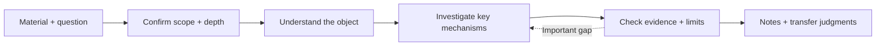

<div align="center">


# ResearchLens

### Understand mechanisms. Check evidence. Transfer principles.

A research analysis skill for papers, software systems, and technical proposals.

[](SKILL.md)
[](#what-you-get)
[](README.md)

[Example](docs/example-analysis.md) · [Quick start](#quick-start) · [Related tools](#where-it-fits) · [Protocol](SKILL.md)

</div>

---

Give ResearchLens a paper, an open-source system, or a technical proposal, together with a question. It helps explain **why the design works, what supports its claims, and which principles can carry into your own work**.

Start with the source's structure, examine important decisions, investigate supporting and conflicting evidence where needed, and turn the findings into reusable research notes.

> **Question → Mechanism → Evidence → Boundaries → Transfer**

**ResearchLens** is the display name. The installation directory and skill identifier remain `explore-skill`.

## What you get

| Your question | The analysis delivers |
|---|---|
| What does this paper or system do? | Main argument, problem, structure, modules, and design goals |
| Why use this mechanism? What are the alternatives? | Assumptions, alternatives, trade-offs, and causal reasoning |
| How far does the evidence support the claim? | Supporting evidence, counter-evidence, gaps, and uncertainty |
| Which contributions or decisions deserve closer analysis? | Per-unit analysis: problem → change → mechanism → evidence → limits |
| What can I reuse in my research or project? | Transferable principles, required conditions, mapping limits, and risks |

Final notes follow your questions. Subproblem files retain the sources and investigation history.

## A worked explanation

Consider this skill's rule that the lead agent decides which follow-up questions to investigate:

| Step | Explanation |
|---|---|
| **Question** | How can an investigation deepen without uncontrolled scope growth? |
| **Mechanism** | Researchers return evidence, gaps, and candidates; the lead merges candidates and promotes those that affect the final judgment |
| **Evidence** | The protocol directly documents this design intention; its effectiveness needs task-level evaluation |
| **Limits** | Separate context does not automatically provide independent evidence; the lead can misjudge priorities |
| **Transfer** | The pattern can inform document review or technical selection when subquestions and judgment criteria are clear |

This is an editorial explanation of the repository's rules, not a recorded skill run or performance evaluation. See the [source-backed example note](docs/example-analysis.md).

## Quick start

### 1. Install the complete directory

These commands describe a first manual installation. You need Git and an agent environment that loads skill files.

**Codex · Windows PowerShell**

```powershell
git clone https://github.com/Tayhirro/explore-skill.git
New-Item -ItemType Directory -Force "$env:USERPROFILE\.codex\skills" | Out-Null
Copy-Item -Recurse .\explore-skill "$env:USERPROFILE\.codex\skills\explore-skill"
```

**Codex · macOS / Linux**

```bash
git clone https://github.com/Tayhirro/explore-skill.git
mkdir -p ~/.codex/skills
cp -R explore-skill ~/.codex/skills/explore-skill
```

Start a new session to load the skill. If already installed, update the existing installation rather than creating a nested copy.

Keep `SKILL.md`, all three `config-*.md` files, and the entire `tasks/` directory. Other Agent Skills hosts can load the complete directory through their own installation process. Evidence gathering requires available search tools; complex delegated investigations require subagent support.

### 2. Supply the material and your question

```text
Use explore-skill to analyze this paper:
<paper URL or local PDF path>

For each core contribution, explain the problem it addresses,
why the mechanism works, how far the experiments support it,
and what could transfer to my research.
```

```text
Use explore-skill to compare these two systems:
<repository A> <repository B>

Focus on important design decisions, alternatives, assumptions,
and principles I could reuse.
My project constraints: <context and constraints>
```

The current protocol requires confirmation of the investigation plan. Task type determines subsequent depth: simple mechanisms can be explained directly; deep contribution analysis and multi-object comparisons require more extensive investigation.

## Where it fits

ResearchLens focuses on **understanding existing work, assessing evidence, and transferring principles**.

| Related skill or project | Primary emphasis | ResearchLens emphasis |
|---|---|---|
| [Nature Paper X-Ray](https://github.com/Yuan1z0825/nature-skills/tree/main/skills/nature-paper-xray) | Close reading of one paper, numerical examples, design decisions, and evidence limits | A shared analysis method for papers, systems, and proposals, with question-led external investigation and transfer judgments |
| [Academic Research Skills](https://github.com/Imbad0202/academic-research-skills) | Literature synthesis, reports, writing, review, and revision | Research notes organized around mechanisms and design decisions |
| [Feynman](https://github.com/Companion-Inc/feynman) | CLI workflows for retrieval, verification, briefs, reviews, and experiments | Host-executed instructions for analysis and reusable notes |
| [Research Companion](https://github.com/andrehuang/research-companion) | Ideation, direction evaluation, and pursue/park/kill decisions | Mechanisms, limits, and transferable principles in existing objects |
| [ARIS](https://github.com/wanshuiyin/Auto-claude-code-research-in-sleep) | Cross-model review and research/experiment improvement loops | Lead-managed peer investigations, selective deepening, and synthesis |
| [Autoresearch](https://github.com/karpathy/autoresearch) | Experimental feedback and keep/discard optimization | Evidence-calibrated research judgments |

Mechanism analysis, verification, and multiple agents also appear in related tools. The positioning here comes from the combination of question-led analysis, per-unit investigation, object-specific adaptation, and bounded transfer. This is a protocol comparison, not a performance ranking. See the [comparison notes](docs/positioning.md).

## How it works



- Keep the source's structure and the user's question as the backbone.
- Analyze concrete mechanisms or decisions, and record follow-up dispositions.
- Let the lead schedule peer investigators; investigators return candidates rather than creating descendants.
- Weaken claims when evidence is partial, and retain uncertainty.
- Use task-appropriate depth. The current protocol supports orientation, focused investigation, claim verification, and further lead-scheduled follow-ups.

The authoritative execution rules are in [SKILL.md](SKILL.md), the object configurations, and the task protocols. These instructions are primarily in Chinese.

<details>
<summary><strong>Files and execution entry points</strong></summary>

```text
explore-skill/
├── SKILL.md
├── config-paper.md
├── config-system.md
├── config-tech.md
├── tasks/
├── README.md
├── README_EN.md
├── assets/
└── docs/
```

[Paper configuration](config-paper.md) · [System configuration](config-system.md) · [Technical configuration](config-tech.md) · [Task protocols](tasks/)

Research state, subproblem files, and round outputs live in the working project's `tmp/`. Final notes retain the useful conclusions; process files retain the investigation history.

</details>

## Scope and feedback

This repository provides instructions and configuration. Output quality depends on available material, retrieval, host execution, and human review. Concept mappings should explain their limits, and citation checks should inspect what the original source actually supports.

Use [Issues](https://github.com/Tayhirro/explore-skill/issues) to share a concrete question, source material, an omitted mechanism or evidence gap, and the analysis you expected.

[中文 README](README.md) · [Visual prompts](docs/image-prompts.md) · [Comparison notes](docs/positioning.md)
